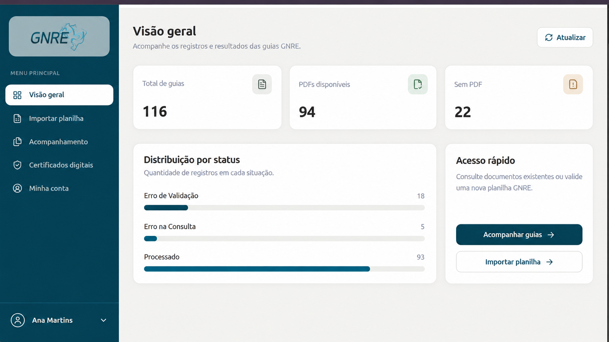
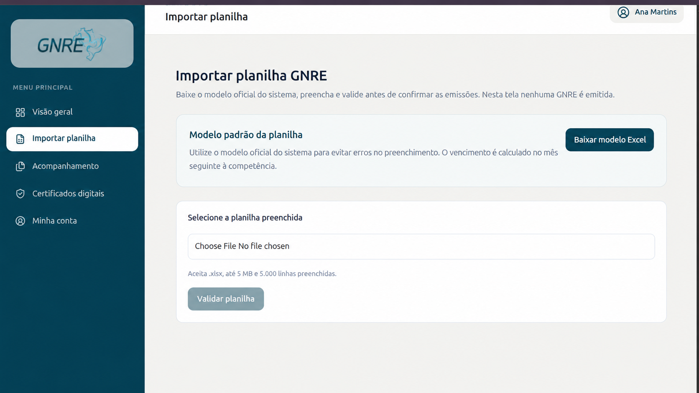
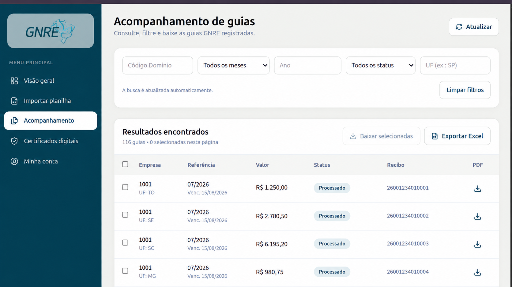
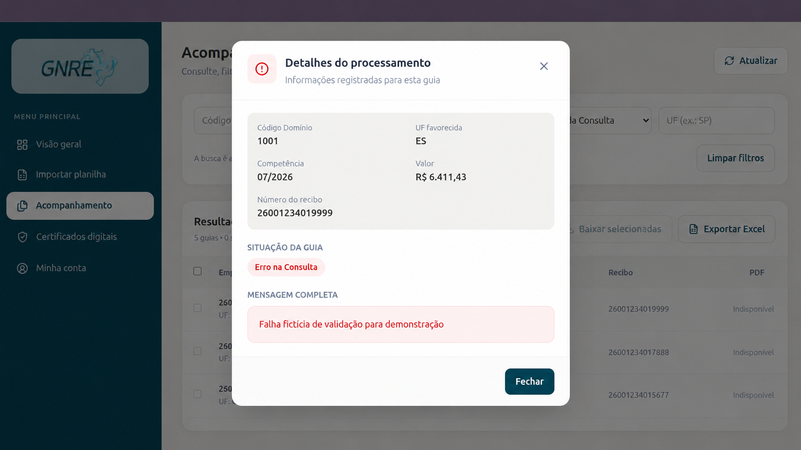
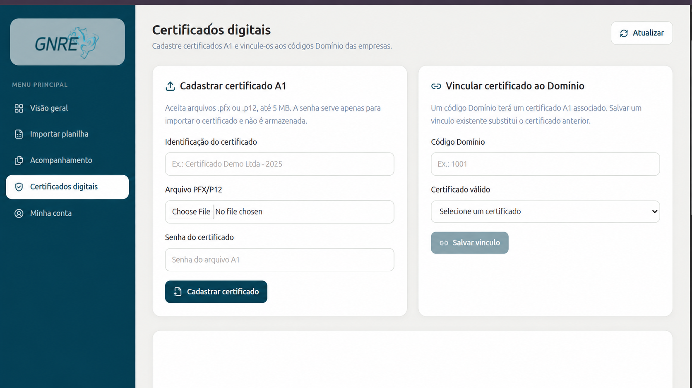
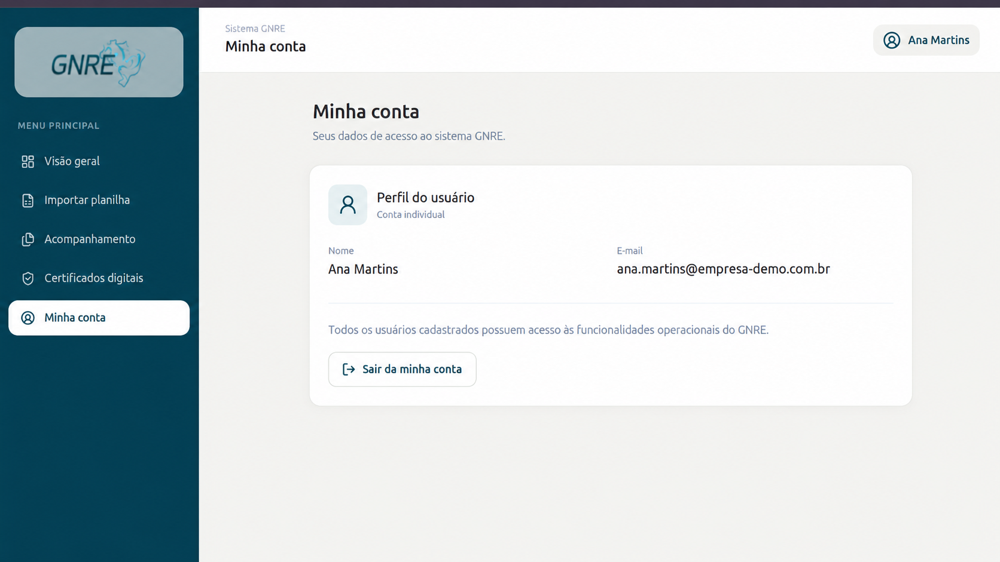

# GUIA GNRE

<p align="center">
  
</p>

<p align="center">
  <strong>Gestão de guias GNRE com validação, acompanhamento, certificados digitais e download de PDFs.</strong>
</p>

<p align="center">
  
  
  
  
  
</p>

> **Observação:** as imagens deste README utilizam **dados fictícios** para demonstração.

---

## ✨ Visão geral

O **GUIA GNRE** é uma aplicação web para centralizar o fluxo operacional de guias GNRE, incluindo:

- validação de planilhas de importação;
- acompanhamento dos registros processados;
- download individual ou em lote de PDFs;
- exportação dos resultados para Excel;
- cadastro e vínculo de certificados digitais A1;
- autenticação de usuários e recuperação de senha.

A aplicação foi construída com **FastAPI no backend** e **React + Vite no frontend**, reaproveitando a base histórica em **SQLite**.

---

## 🖼️ Demonstração

### Login

<p align="center">
  
</p>

### Visão geral

<p align="center">
  
</p>

### Importação de planilha

<p align="center">
  
</p>

### Acompanhamento de guias

<p align="center">
  
</p>

### Detalhes do processamento

<p align="center">
  
</p>

### Certificados digitais

<p align="center">
  
</p>

### Minha conta

<p align="center">
  
</p>

---

## 🚀 Principais funcionalidades

### Dashboard
- total de guias registradas;
- quantidade de PDFs disponíveis;
- guias sem PDF;
- distribuição por status.

### Importação de planilha
- download do modelo padrão;
- validação de `.xlsx` antes da emissão;
- verificação de colunas obrigatórias;
- validação de competência, vencimento, UF, receita e valor.

### Acompanhamento de resultados
- listagem paginada;
- filtros por código domínio, mês, ano, UF e status;
- visualização de recibo e situação da guia;
- detalhamento da mensagem de erro.

### Arquivos
- download de PDF individual;
- download em lote via `.zip`;
- exportação dos resultados em `.xlsx`.

### Certificados digitais
- cadastro de certificado A1 (`.pfx` / `.p12`);
- criptografia do material sensível;
- vínculo de certificado por código domínio.

### Autenticação
- login com sessão persistida em cookie HttpOnly;
- recuperação de senha por e-mail;
- tela de perfil do usuário.

---

## 🧱 Arquitetura

```text
Frontend (React + Vite)
        │
        ▼
Backend API (FastAPI)
        │
        ├── validação de planilhas
        ├── listagem e filtros
        ├── exportação Excel
        ├── download de PDFs
        ├── gestão de certificados
        ├── autenticação de usuários
        └── integração GNRE (XML / SOAP / consulta)
        │
        ▼
SQLite (histórico das guias e tabelas auxiliares)
```

---

## 🗂️ Estrutura do projeto

```text
guia_GNRE/
├── backend/
│   ├── app/
│   │   ├── routes/
│   │   ├── services/
│   │   ├── workers/
│   │   ├── main.py
│   │   ├── models.py
│   │   └── config.py
│   ├── assets/
│   ├── data/
│   ├── media/
│   ├── requirements.txt
│   └── .env
├── frontend/
│   ├── public/
│   ├── src/
│   │   ├── components/
│   │   ├── pages/
│   │   └── services/
│   ├── package.json
│   └── vite.config.ts
└── docs/
    └── assets/
```

---

## ⚙️ Tecnologias utilizadas

### Backend
- Python
- FastAPI
- SQLAlchemy
- Pydantic
- OpenPyXL
- Requests
- LXML
- SignXML
- Cryptography

### Frontend
- React
- TypeScript
- Vite
- CSS

### Dados e integração
- SQLite
- Certificados digitais A1
- XML GNRE
- Webservice SOAP GNRE

---

## 🛠️ Como executar o projeto

## 1) Clonar o repositório

```bash
git clone <URL_DO_REPOSITORIO>
cd guia_GNRE
```

## 2) Backend

```bash
cd backend
python -m venv .venv
```

### Windows

```bash
.venv\Scripts\activate
pip install -r requirements.txt
uvicorn app.main:app --reload --port 4500
```

### Linux / macOS

```bash
source .venv/bin/activate
pip install -r requirements.txt
uvicorn app.main:app --reload --port 4500
```

## 3) Frontend

Em outro terminal:

```bash
cd frontend
npm install
npm run dev
```

O frontend ficará disponível em algo como:

```text
http://127.0.0.1:5173
```

---

## 🔐 Variáveis de ambiente

Exemplo de configurações do backend:

```env
APP_NAME=Sistema GNRE
APP_VERSION=2.0.0
ENVIRONMENT=development

DATABASE_PATH=data/db.sqlite3
MEDIA_ROOT=media

AUTH_COOKIE_SECURE=false
FRONTEND_PUBLIC_URL=http://127.0.0.1:5173
CORS_ORIGINS=http://localhost:5173,http://127.0.0.1:5173

SMTP_SERVER: str = ""
SMTP_PORT: int = 587
SMTP_USER: str = ""
SMTP_PASSWORD: str = ""

CERTIFICATE_ENCRYPTION_KEY=
GNRE_ADMIN_API_KEY=
GNRE_ENVIOS_HABILITADOS=false
GNRE_WEBSERVICE_URL=https://www.gnre.pe.gov.br/gnreWS/services/GnreLoteRecepcao
GNRE_RESULTADO_WEBSERVICE_URL=https://www.gnre.pe.gov.br/gnreWS/services/GnreResultadoLote
```

> **Importante:** nunca publique `.env`, bancos reais, certificados ou dados de produção.

---

## 🔄 Fluxos principais

### Validação de planilha
1. baixar o modelo Excel;
2. preencher os dados da GNRE;
3. enviar a planilha;
4. validar campos obrigatórios e consistência;
5. exibir prévia e retorno ao usuário.

### Acompanhamento
1. consultar as guias já registradas;
2. aplicar filtros por empresa, competência, UF e status;
3. abrir detalhes do processamento;
4. baixar PDF individual ou em lote;
5. exportar os resultados para Excel.

### Certificados digitais
1. cadastrar certificado A1;
2. informar senha apenas para importação;
3. vincular o certificado a um código domínio;
4. utilizar o vínculo nas operações GNRE.

---

## 📌 Situação atual do projeto

O **GUIA GNRE** encontra-se em fase de finalização, com a interface, os serviços internos e o fluxo de integração GNRE implementados.

### Funcionalidades implementadas

- Autenticação de usuários e recuperação de senha;
- Dashboard e acompanhamento de guias;
- Importação e validação de planilhas Excel;
- Controle de processamento e prevenção de envios duplicados;
- Cadastro, armazenamento criptografado e vínculo de certificados digitais A1;
- Conversão de certificados PFX/P12 para material PEM;
- Geração e assinatura digital de XML GNRE 2.00;
- Montagem de requisições SOAP para integração com o webservice GNRE;
- Tratamento de recibos, consulta de processamento e respostas com PDFs;
- Download e exportação de guias e resultados.

### Testes realizados

Foram realizados testes locais para validar os componentes essenciais da integração, incluindo:

- Recuperação e leitura do certificado digital armazenado;
- Verificação de correspondência entre certificado e chave privada;
- Geração e assinatura digital do XML;
- Verificação criptográfica da assinatura;
- Carregamento do material PEM pela biblioteca SSL;
- Preservação da assinatura digital após a montagem do envelope SOAP;
- Validação de planilhas e execução das rotinas internas de processamento.

**Os testes locais de certificado e assinatura foram concluídos com sucesso.**

### Limitação dos testes de integração

**A emissão real de uma GNRE pelo novo sistema ainda não foi validada com sucesso.**

Foram realizadas tentativas de integração utilizando o ambiente de homologação da GNRE, mas a comunicação foi interrompida durante a validação HTTPS do certificado apresentado pelo servidor.

O endereço de homologação utilizado apresentou incompatibilidade entre o nome do domínio acessado e o certificado SSL/TLS disponibilizado, resultando no erro:

`SSL: CERTIFICATE_VERIFY_FAILED — Hostname mismatch`

O problema foi reproduzido por meio de testes com cURL e Python Requests.

Consequentemente, ainda não foram comprovadas, em uma operação completa com o webservice oficial:

- a aceitação do XML assinado pelo serviço GNRE;
- a obtenção de um recibo real de processamento;
- a consulta bem-sucedida do lote transmitido;
- o recebimento e armazenamento de um PDF real gerado pelo webservice.

### Considerações antes da utilização em produção

A integração está implementada e passou pelas validações técnicas locais, mas **não deve ser considerada homologada para utilização em produção sem um teste real, controlado e autorizado**.

Antes da liberação operacional, recomenda-se validar o envio e a consulta no ambiente oficial apropriado, conferir os recibos e PDFs retornados e revisar possíveis processamentos com resultado indeterminado.

O envio de guias permanece sujeito à configuração explícita `GNRE_ENVIOS_HABILITADOS`, desabilitada por padrão no exemplo de configuração.

**Status da integração GNRE:** implementada, com validações locais concluídas e teste completo de emissão real ainda pendente.

---

## 🔒 Segurança

Este projeto lida com informações sensíveis e certificados digitais. Recomendações:

- use `.env` fora do versionamento;
- mantenha a chave `CERTIFICATE_ENCRYPTION_KEY` protegida;
- nunca publique arquivos `.pfx`, `.p12`, `.pem` e bancos reais;
- habilite `AUTH_COOKIE_SECURE=true` em produção com HTTPS;
- revise acesso a cadastros e rotas administrativas.

---

## 📷 Assets do README

Sugestão de organização no repositório:

```text
docs/
└── assets/
    ├── gnre-demo.gif
    ├── login.png
    ├── visao-geral.png
    ├── importar-planilha.png
    ├── acompanhamento.png
    ├── detalhes-processamento.png
    ├── certificados-digitais.png
    └── minha-conta.png
```

---
